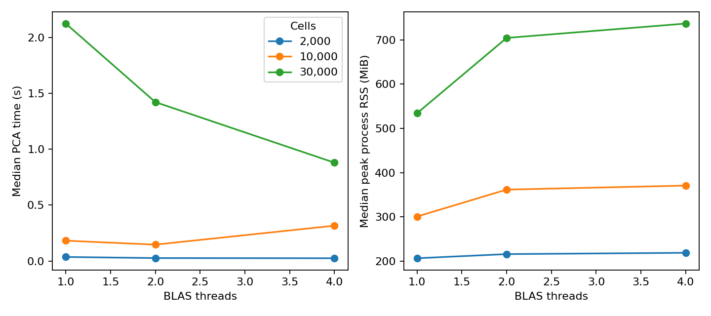

# How does CPU thread count affect lymph node expression-matrix PCA?

At 30,000 cells and 1,000 targets, median PCA time over three fresh processes fell from 2.12 s with one thread to 0.88 s with four. All 27 runs met the 10⁻⁵ explained-variance-ratio tolerance.



## Study design

Read section W19 of GSE336618. Exclude identifiers and control probes. Freeze a seeded permutation and take nested samples of 2,000, 10,000 and 30,000 cells. Normalize library sizes, log transform and compute 12 randomized PCs. Start a fresh worker per repeat. Record stage time and sampled peak process RSS at 10 ms intervals.

Timings describe one Windows CPU host. OS page cache can persist across processes. Explained-variance agreement tests one numerical endpoint. Nextflow and Slurm definitions are supplied; the measured runs used the local Python entry point.

## Reproduce

Use Python 3.12 from this directory in a fresh virtual environment. The analysis downloads the cited public inputs on its first run. Set `BSC_CACHE` to reuse an existing private cache. The offline tests run with the core dependencies.

```sh
python -m pip install -r requirements.txt
python -m unittest discover -v
python verify.py
python analysis.py
```

The checksum command verifies the committed release. Reruns can change benchmark timings, compressed file timestamps and rendered graphics.

## Data and results

- [Primary results](results/benchmark_runs.csv)
- [All output tables and figures](results/)
- [Input provenance and checksums](data/sources.json)
- [Protocol](docs/protocol.md)
- [Original data or method](https://www.ncbi.nlm.nih.gov/geo/query/acc.cgi?acc=GSE336618)

The MIT license covers repository code. Original datasets, model weights and structural coordinates retain the terms of their providers. Only aggregate results are redistributed here.
